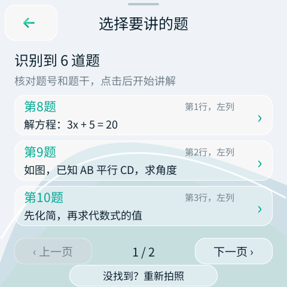

# Mosaico 学习助手（Vibe Mode 0.2 版）


把 ESP-Mosaico 变成一台**会拍题讲解、会听你提问、还会把答案读出来**的随身 AI 学习机。

孩子日常使用**不需要手机**：拍一张试卷照片，设备先列出"这张纸上有哪几道题"，点选要讲的那一道，AI 才开始一步步讲解；或者按住顶部的 AI 键说话提问，屏幕上先确认识别出的文字，再发送。所有讲解由阿里云百炼的通义千问大模型完成（需要你自己的 API Key，按量付费）。

> 本仓库是 [samyeei/mosaico-learning-assistant](https://github.com/samyeei/mosaico-learning-assistant) v1.0.0 的 **Vibe Mode 0.2（Recovery ABI 2）移植版**。上游 v1.0.0 固件是旧版 ABI 1 包，不能装在新一代设备上；本移植版就是为解决这个问题——**应用源码零改动**，只调整了构建配置，详见[移植说明](#移植说明)。
>
> **仓库形态**：独立镜像，只含应用本身。构建依赖 ESP-Mosaico 官方工作区的 `mosaico.py` 工具链、Git 子模块（esp-mosaico-utils / esp-mosaico-bsp）和本地 esp-gsp 1.5.1 克隆，**单独 clone 无法直接构建**——请把本仓库克隆到工作区的 `projects/` 目录后按下面步骤操作。

---

## 它能做什么

| 功能 | 通俗描述 |
|---|---|
| 📷 拍题选题 | 拍一张照片 → AI 只认题不解答，列出最多 24 道题（每页 3 题，可翻页）→ 点选后才讲解；同一张照片可以"换一题"，不用重拍 |
| 🎤 语音提问 | 点大麦克风或按住顶部 AI 键录音（最长 30 秒），识别成文字先确认、再发送，松手不会误发 |
| 💬 追问 | 讲解页继续提问，AI 自动结合"当前选中的题 + 原始照片 + 之前的问答"来回答："第二步为什么这样做？""再举个例子" |
| 🔊 朗读 | 手动"朗读/停"；控制面板里可开"自动朗读"，新回答自动读出来 |
| ☀️ 控制面板 | 屏幕顶部下拉：亮度、音量、自动朗读、方向锁；向上滑收起 |
| 🎓 年级 | 一年级到高三（默认初一），影响讲解难度和用词，不绑定教材 |
| 📶 手机配网 | 设备开免密热点，手机浏览器填家庭 Wi-Fi 和 API Key，先测试、后保存 |

原生选题页示意（题目为演示数据，非真实识别结果）：



## 需要准备什么

| 东西 | 说明 |
|---|---|
| 设备 | ESP32-S31 / ESP-Mosaico，16 MiB Flash，基础固件为 Vibe Mode 0.2（Recovery ABI 2） |
| 摄像头插件 | 拍题必需，装在设备**左侧插槽**（装前关机、对准方向、不要强插）；麦克风/扬声器板载，不用另配 |
| 网络 | 能上网的家庭 **2.4 GHz** Wi-Fi |
| API Key | [阿里云百炼](https://bailian.console.aliyun.com/) 的模型调用密钥（`sk-` 开头）。设备用到三个模型：`qwen3-vl-plus`（看图讲解）、`qwen3-asr-flash`（语音识别）、`qwen3-tts-flash`（朗读）。Key 分**北京/新加坡**两种地域，不能混用；权限需覆盖这三类模型，费用由你的账号按量承担 |

## 安装固件

本移植版按 Vibe Mode 0.2 的标准应用工作流安装（**不要**使用上游 v1.0.0 的旧版 ZIP/irisfw，那是不兼容的旧 ABI 包）。下文假设仓库已克隆到工作区的 `projects/esp-mosaico-learning-assistant`：

1. 准备 ESP-Mosaico 工作区（[esp-mosaico 官方仓库](https://github.com/esp-mosaico/esp-mosaico-vibe)），初始化子模块：
   ```bash
   git submodule update --init submodule/esp-mosaico-utils submodule/esp-mosaico-bsp
   ```
2. 按下面"从源码构建"一节编译应用（或使用已构建产物）。
3. 用官方工具确认唯一目标设备：
   ```bash
   python mosaico.py iris status --all --json
   python mosaico.py iris list --details --json
   ```
4. 安装（新应用/新布局必须走系统更新，不能用 app-update）：
   ```bash
   python mosaico.py iris system-update --project projects/esp-mosaico-learning-assistant
   ```
5. 核对更新记录、重启后的新 Boot ID，再实测拍照/语音/触摸/联网。**上传成功不等于验收通过。**

> 不要整片擦除、不要只刷应用 bin、不要抢占其他客户端正在使用的设备。

## 第一次使用（家长操作，约 5 分钟）

1. **拿 Key**：打开[百炼控制台](https://bailian.console.aliyun.com/)，在北京（或新加坡）地域的 API Key 页面创建并复制**完整**的 `sk-...` 密钥。
2. **连热点**：打开学习助手，首次会自动进入"连接与设置"，点"用手机配置 Wi-Fi 和 Token"，设备显示热点名 `Learn-Setup-XXXX`。
3. **开网页**：手机 Wi-Fi 连上这个免密热点（提示"无法上网"选保持连接——连的就是设备本身），浏览器打开 **http://192.168.4.1**。
4. **填三项**：扫描选择家庭 Wi-Fi → 填路由器密码 → 粘贴 API Key（北京 Key 选"中国内地（北京）"，新加坡 Key 选"国际（新加坡）"）。
5. **先测试再保存**：点"测试 Wi-Fi 和 Token"，设备会真的去连家庭 Wi-Fi、同步时间、用你的 Key 发一次迷你请求；全部通过后再点"保存配置"，设备自动重启。手机即可切回家中 Wi-Fi。

以后换路由器或换 Key：屏幕顶部下拉 → 齿轮 → "用手机配置 Wi-Fi 和 Token"，重复上面步骤。

## 日常使用速查

**拍题**：首页点"拍题讲解" → 取景确认画面在动 → 拍清**题号 + 完整题干 + 选项 + 图形**（暗处点"补光"，镜头翻到前面用 180° 图标调朝向）→ 点快门 → 清楚就"识别题目" → 从清单里**点选要讲的那道题** → 讲解后可"换一题"。密集卷子认不全时，分区域拍更容易看清。

**语音**：首页点"问个问题" → 点麦克风或按住 AI 键说话 → 松开 → 翻看识别文字，错了点"重新说"，对了点"确认发送" → 讲解页可继续追问。

**看回答**：上一页/下一页翻页；"换个讲法"重新解释；"朗读/停"控制播放；左上角大返回键退出。

> AI 识别和解题都可能出错，请对照原题检查；照片里不要拍到姓名、学号等个人信息。

## 隐私与安全设计

- 照片、录音和问题**只发给你自己配置的云服务**；照片只存在内存里用于当次讲解，**从不写入 flash**；
- API Key 只存在设备 NVS，永不上报；所有模型请求走 TLS 证书校验（配置页会先同步时钟，绝不关证书校验）；
- 配置网页只绑在设备热点上、带一次性 nonce 防跨站请求；朗读音频只允许从 `*.aliyuncs.com` 下载；
- 设备提示词内置防注入指令：试卷上印的任何"指令"都不会改变 AI 的角色；
- 官方 Recovery 通道始终可达，UI 资源损坏也不会把设备刷成砖。

请保管好 Key：不要发到评论区、Issue、群聊或公开截图；泄漏后在百炼控制台停用重建。

## 从源码构建

固定版本：Python 3.10+；ESP-IDF 精确为 commit `7b9cc1ac79f865983f59bb8ff3ff43eb74ff1dbe`（目标 esp32s31）；GSP 1.5.1、GSPC 0.6.1、LVGL 9.5.0；子模块只初始化 utils 和 BSP。esp-gsp 1.5.1 已从组件 CDN 下架（403），组件清单通过 `override_path` 引用本地克隆（本工作区验证过的路径是 `weiqi-solution/dev/esp-gsp`，其他环境请指向自己的 esp-gsp 1.5.1 检出，目录名保持 `esp-gsp`）。

```powershell
# Windows 一键构建（全量约 6-7 分钟；路径按你的克隆位置调整）
powershell -ExecutionPolicy Bypass -File projects\esp-mosaico-learning-assistant\tools\local.ps1 build

# 宿主单元测试（7 组，无需设备/IDF）
# pc/ 目录下的 learning_model、questions、controls、speech_conversation、
# orientation_logic、viewport、provider_protocol 测试可用任意 C11 编译器单独编译运行

# 打包校验（无设备也能做）
python submodule/esp-mosaico-utils/mosaico-tools/tools/prepare_system_update.py --help
```

产物：`build/learning_assistant.bin`（约 10.2 MB，进 ota_0 分区 11.5 MB）和 `build/ui_apps.bin`（UI 资源约 1.97 MB，进 ui_apps 分区 3 MB）。字体（LearningSans，含 DejaVu 数学字形补齐）与图标已包含在仓库，普通构建无需重新生成美术源图。

## 移植说明

移植自上游 v1.0.0（旧版 Recovery ABI 1 / layout 4 / GSP 1.4.0），**应用源码零改动**（`main/` 全部 C 源码、`ui/` 场景与素材、分区表均未动），只调整了 3 个文件：

| 文件 | 改动 |
|---|---|
| `main/idf_component.yml` | esp-gsp 升到 1.5.1（本地克隆 override） |
| `CMakeLists.txt` | 删除旧版 GSPC 0.5.0 适配器，改用共享引导脚本解析应用版 GSPC 0.6.1 |
| `tools/local.ps1` | 对齐本工作区 ESP-IDF 与构建配方 |

为什么能零改动：GSP 1.5.1 保留了应用用到的全部接口；UI 资源加载方式虽改为 ui_apps 分区（mmap + SHA-256 校验），但 `ui_bundle_open()` 签名不变；Recovery 应用契约（不可变前缀、`iris_ota_support_start()`、OTA writer 只在 Vibe Mode）本来就遵守。详细盘点与验证记录见 [docs/PORT_VIBE02_CN.md](docs/PORT_VIBE02_CN.md)。

**当前验证状态（如实说明）**：7 组宿主单元测试全部通过；固件构建、ui_apps 打包和系统更新 staging 校验通过；**真机安装与全功能验收尚待设备**。UI 资源由 GSPC 0.6.1 重新编译（上游用 0.5.0），首次真机验收时请重点确认全部页面渲染与摄像头/补光行为。

## 目录结构

```
projects/learning_assistant/
├── main/            # 应用源码：状态机、云端协议、配网、相机、语音、运行时
│   ├── learning_model.c      # 10 页 UI 状态机（单所有者，队列+代号防串台）
│   ├── learning_provider.c   # 百炼三模型调用（认题/讲解/ASR/TTS）
│   ├── learning_network.c    # 家庭 Wi-Fi + 配置热点 + 设置网页
│   ├── learning_camera.c     # DVP 取景/拍照/JPEG 编码（照片不落盘）
│   └── setup.html            # 手机配网页（192.168.4.1）
├── ui/              # GSP 场景源（main.json）+ 字体 + 图标
├── pc/              # 7 组宿主单元测试 + PC 平台桩
├── tools/           # 构建/模拟/测试快捷脚本
└── docs/            # 移植记录（PORT_VIBE02_CN.md）与图片
```

## 许可与致谢

- 原创代码来自 [samyeei/mosaico-learning-assistant](https://github.com/samyeei/mosaico-learning-assistant)，采用 **PolyForm Noncommercial 1.0.0**（源码公开、**禁止商业使用**）。
  > Required Notice: Copyright 2026 Samyeei (https://github.com/samyeei)
- 本移植版的构建配置改动遵循同一许可；上游 `board_display` 适配器为 Apache-2.0；字体（Noto Sans SC 为 SIL OFL 1.1，DejaVu 字形保留原许可）与 ESP-Mosaico 上游组件保留各自许可，详见 [THIRD_PARTY_NOTICES.md](THIRD_PARTY_NOTICES.md)、[LICENSES/](LICENSES) 与 `ui/fonts/` 内的许可文件。
- 封面与图标为 AI 生成示意；设备型号 ESP32-S31 / ESP-Mosaico 与 Mosaico 工具链来自 [esp-mosaico](https://github.com/esp-mosaico) 项目。
